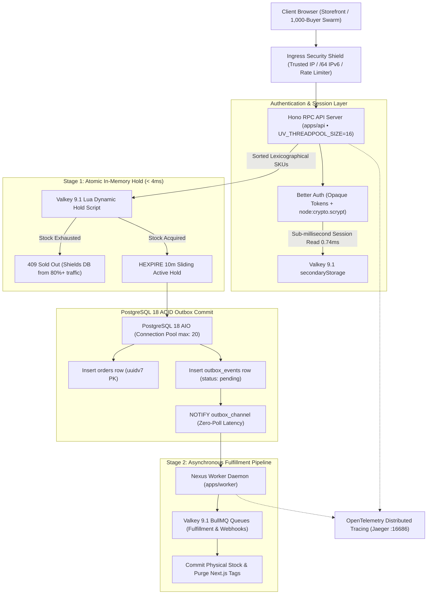

<div align="center">

# ⚡ NEXUS COMMERCE

### Enterprise High-Concurrency Direct-to-Consumer Engine & Flash-Sale Platform

**Dual-Engine Architecture: PostgreSQL 18 AIO + Valkey 9.1 + Next.js 16 + Hono RPC + BullMQ**

[](https://nodejs.org/)
[](https://turbo.build/)
[](https://www.typescriptlang.org/)
[](https://nextjs.org/)
[](https://hono.dev/)
[](https://www.postgresql.org/)
[](https://valkey.io/)
[](https://bullmq.io/)
[](https://opentelemetry.io/)
[](https://biomejs.dev/)

</div>

---

## 📌 Executive Summary

**Nexus Commerce** is an enterprise-grade, high-concurrency commerce engine architected specifically to withstand **severe flash-sale bursts (1,000+ simultaneous buyers competing for limited inventory)** without deadlocks, without double-spending, and with **mathematical zero overselling**.

Traditional monoliths collapse under flash sales because they push atomic inventory contention into row-level database locks (`SELECT FOR UPDATE`), leading to connection pool exhaustion, multi-second tail latencies, and PostgreSQL dead-tuple MVCC bloat. Nexus Commerce solves this by pairing **Valkey 9.1 RAM atomic reservation scripts** with an **asynchronous 2-Stage PostgreSQL 18 Transactional Outbox $\rightarrow$ BullMQ fulfillment pipeline**.

---

## 🏗️ System Architecture & End-to-End Flow



---

## 🛡️ Core Concurrency Invariants

### 1. Dynamic `HEXPIRE 10m` Sliding Hold (Zero Overselling)
Rather than writing pending holds to PostgreSQL or decrementing static integer counters, Nexus stores holds inside a Valkey Hash: `holds:{sku} -> { customerId: quantity }`.
* When a user adds an item to cart or initiates checkout, the atomic Lua script verifies that:
  $$\text{Physical Stock} - \sum(\text{Active Holds}) \ge \text{Requested Quantity}$$
* If valid, it records the hold and attaches a 10-minute sliding TTL (`HEXPIRE`).
* If a customer abandons their cart, Valkey **passively expires the hash field**, instantly and automatically restoring inventory to the pool without counter drift or cron jobs.

### 2. Lexicographical SKU Lock Ordering (Deadlock-Free Checkouts)
When multi-item carts compete for inventory (e.g., Buyer 1 holds `[SKU-B, SKU-A]` while Buyer 2 holds `[SKU-A, SKU-B]`), naive systems suffer relational deadlocks (`40P01`).
* Nexus sorts all cart items lexicographically by SKU prior to acquiring Valkey memory locks and database rows:
  $$\text{Target Order} = \text{items.sort}((a, b) \implies a.\text{sku.localeCompare}(b.\text{sku}))$$
* Lock acquisition order is globally deterministic across all concurrent workers, mathematically preventing circular wait conditions.

### 3. Two-State Idempotency Spin-Wait (`SET NX EX 86400`)
To prevent double-charging on rapid customer double-clicks or aggressive network retries:
* The first request acquires an exclusive state lock in Valkey (`SET lock:idempotency:{key} "PROCESSING" NX EX 120`).
* Concurrent duplicate requests detect the `PROCESSING` lock and enter an exponential backoff spin-wait poll.
* As soon as the first transaction commits (`SET lock:idempotency:{key} "SUCCESS" EX 86400`), all waiting requests return the **identical cached response (HTTP 200)** in **`< 1ms`** without duplicating charges or inventory deductions.

---

## ⚡ The 2-Stage Queue Pipeline

To balance sub-second checkout speeds with asynchronous durability, Nexus uses a **two-stage pipeline**:

```
[ POST /api/orders ]
         │
         ▼  (ACID Transaction)
┌─────────────────────────────────┐
│ 1. orders (uuidv7)              │
│ 2. outbox_events (pending)      │──► NOTIFY outbox_channel
└─────────────────────────────────┘           │
         │ (HTTP 201 Created)                 ▼  (Instant Worker Pickup)
         ▼                            ┌───────────────────────────────┐
Client Receives Receipt               │ Stage 2: Valkey 9.1 BullMQ    │
                                      │  • orders-fulfillment queue   │
                                      │  • webhook-dispatch queue     │
                                      └───────────────────────────────┘
```

1. **Stage 1: Transactional Outbox (PostgreSQL 18):**
   * Eliminates the dual-write bug. The order and its outbox event are committed in the **exact same database transaction**.
   * Emits a native `NOTIFY outbox_channel` event. The standalone worker wakes up instantly without aggressive polling loops.
2. **Stage 2: Valkey 9.1 BullMQ Relay (apps/worker):**
   * Dedicated BullMQ workers consume the event, process physical inventory commitments, generate tax invoices, dispatch carrier webhooks, and trigger Next.js ISR cache revalidations.

---

## 📊 Hardware Sizing & Capacity Matrix

System capacity is mathematically governed by **Little’s Law** ($L = \lambda \times W$). Because Valkey intercepts 80%+ of excess flash-sale traffic in RAM before it reaches the database, Nexus sustains enterprise throughput on modest hardware:

| Hardware Tier | CPU & Memory Profile | Ideal Concurrency ($p95 < 200\text{ms}$) | Maximum Peak Burst ($p99 < 800\text{ms}$) | Sustained Throughput | Primary Limiting Bottleneck | Recommended Tuning Invariants |
| :--- | :--- | :--- | :--- | :--- | :--- | :--- |
| **Tier 1: Starter Cloud Pod** | 1–2 vCPU • 2 GB RAM *(e.g. AWS t4g.small)* | **`50 – 100`** buyers | **`200`** buyers | `~150 RPS` | Node Event Loop CPU & V8 Heap | PG pool: `5–10`, `UV_THREADPOOL_SIZE=4`, Valkey `maxmemory 512mb` |
| **Tier 2: Host Benchmark** | **10 Cores • 16 GB RAM** *(Apple M1 Pro)* | **`250 – 500`** buyers | **`1,000`** buyers | **`~1,200 RPS`** | PostgreSQL Pool Size (`max: 20`) | `UV_THREADPOOL_SIZE=16`, Valkey Lua pipeline active |
| **Tier 3: Standard Production** | 4 vCPU • 8 GB RAM *(e.g. AWS c7g.xlarge)* | **`500`** buyers | **`1,250`** buyers | `~800 RPS` | Database Disk WAL Writes (`fsync`) | PG pool: `20–30`, `UV_THREADPOOL_SIZE=16`, Valkey `maxmemory 2gb` |
| **Tier 4: Enterprise Cluster** | 16 vCPU • 32 GB RAM *(3x API Replicas)* | **`2,500`** buyers | **`5,000+`** buyers | `~4,500 RPS` | OS Network Sockets (`ulimit -n`) | PgBouncer (`100` conns), Valkey Cluster, `somaxconn = 4096` |

*For the complete mathematical derivation and subsystem physics, see [`hardware-capacity-and-concurrency-matrix.md`](./hardware-capacity-and-concurrency-matrix.md).*

---

## 🔒 Enterprise Ingress & Authentication Defense

| Protection Layer | Implementation Mechanism | Latency Profile | Security Guarantee |
| :--- | :--- | :--- | :--- |
| **Password Hashing** | `node:crypto.scrypt` + `UV_THREADPOOL_SIZE=16` | `~65ms` (off-loop) | ASIC-resistant memory-hard hashing with zero native `node-gyp` Alpine compilation risks |
| **Dual-Speed Sessions** | Better Auth `cookieCache` (5m HMAC) + Valkey | **`0.02ms`** (UI) / **`0.74ms`** (API) | Zero network hops on SSR page navigation; instant ban/role enforcement on mutations |
| **Rate-Limit Bypass Shield** | Socket IP Resolution (`@hono/node-server/conninfo`) | `< 0.2ms` | Immune to `X-Forwarded-For` header spoofing; IPv6 `/64` prefix subnet grouping |
| **Dual-Key Rate Limiting** | Atomic Lua Sliding-Window ZSET Limiter | `< 0.5ms` | Dual buckets: IP rate limit (Anti-DoS) + Target Account rate limit (Anti-Credential Stuffing) |
| **BREACH Side-Channel Shield** | Selective HTTP Compression | `0ms` overhead | Gzip compression applied to catalog data; strictly disabled on `/api/auth/**` |
| **Timing-Attack Resistance** | Pre-Hashed SHA-256 `timingSafeEqual` | `< 0.05ms` | Eliminates early-return length leakage on admin secrets and webhook tokens |

---

## 🗂️ Monorepo Topology

```text
nexus-commerce/
├── apps/
│   ├── api/                   # Hono RPC HTTP API Server (port 4000)
│   │   ├── src/index.ts       # Security middleware, rate limiters, route mounting
│   │   └── src/modules/       # Domain modules (orders, products, admin war room)
│   ├── worker/                # Standalone Outbox Relay & BullMQ Consumer
│   │   └── src/index.ts       # LISTEN/NOTIFY listener + 2-stage queue processor
│   └── web/                   # Next.js 16 Storefront & Admin Portal (port 3001)
│       ├── src/app/           # App Router pages (storefront, orders tracking, login, admin)
│       └── src/components/    # Luxury UI components, visual charts, Architecture X-Ray HUD
│
├── packages/
│   ├── auth/                  # Better Auth server configuration + client SDK
│   ├── db/                    # PostgreSQL schema (Drizzle ORM), migrations, seed scripts
│   ├── kv/                    # Valkey 9.1 connection pool + atomic Lua scripts
│   ├── observability/         # OpenTelemetry distributed tracing + Jaeger exporters
│   ├── env/                   # Type-safe Zod runtime environment validation
│   └── tsconfig/              # Strict base TypeScript configurations
│
├── tests/
│   └── stress/
│       ├── flash-sale.test.ts # Bun-powered 100-buyer concurrency stress suite
│       └── k6-flash-sale.js   # Distributed k6 load-testing script
│
├── docker-compose.yml         # Tuned local PostgreSQL 18 AIO, Valkey 9.1, and Jaeger
├── turbo.json                 # Turborepo task pipeline configuration
└── biome.json                 # Biome 2.6.3 formatting and linting configuration
```

---

## 🚀 Quick Start Guide

### Prerequisites
* **Node.js:** `>= 26.0.0` (managed via `.nvmrc`)
* **pnpm:** `^10.0.0` or `^12.0.0`
* **Docker / OrbStack:** For PostgreSQL 18, Valkey 9.1, and Jaeger services

### 1. Clone & Install Dependencies
```bash
git clone https://github.com/minhlu99/nexus-commerce.git
cd nexus-commerce
pnpm install
```

### 2. Start Infrastructure Containers
```bash
# Spins up PostgreSQL 18 (AIO), Valkey 9.1 (Alpine), and Jaeger Tracing
pnpm services:up
```

### 3. Initialize Database & Seed
```bash
# Push Drizzle schema to PostgreSQL
pnpm db:push

# Seed store, products, variants, and inventory in PostgreSQL & Valkey
bun packages/db/src/seed.ts
```

### 4. Launch Full Development Environment
```bash
pnpm dev
```

* 🛍️ **Consumer Storefront:** [http://localhost:3001](http://localhost:3001) *(or port 3000)*
* 🛡️ **Admin War Room & Simulator:** [http://localhost:3001/admin](http://localhost:3001/admin)
* ⚡ **Hono RPC API Server:** [http://localhost:4000](http://localhost:4000)
* 📡 **Jaeger Distributed Tracing UI:** [http://localhost:16686](http://localhost:16686)

---

## 🧪 Testing & Empirical Verification

### 1. In-Browser Concurrency Simulator (Admin War Room)
Navigate to **[http://localhost:3001/admin](http://localhost:3001/admin)** with the seeded `Sarah Admin` account:
1. Select concurrency scale: **`[ 100 ] [ 250 ] [ 500 ] [ 1,000 ]`** simultaneous buyers.
2. Click **`🔥 Launch Flash Surge`**.
3. Inspect the live **Executive Verdict Card**, the **Outcome Distribution Bar**, and the **Latency Distribution Histogram** rendered in real time.

### 2. Automated Bun High-Concurrency Test
Execute a live 100-buyer race condition from the terminal:
```bash
pnpm test:concurrency
```

### 3. Distributed k6 Flash-Sale Spike Test
Run the k6 load test to audit p95 latency thresholds and error rates:
```bash
pnpm test:k6
```

### 4. Headless Typecheck & Linting
```bash
# Strict TypeScript validation across all 9 packages
pnpm typecheck

# Biome 2.6.3 formatting and lint audit
pnpm lint
```

---

## 👥 Seeded Demo Personas

| Persona | Role | Email | Password | Access Privileges |
| :--- | :--- | :--- | :--- | :--- |
| **Alex Customer** | `customer` | `demo.customer@nexus.com` | `DemoPassword123!` | Storefront browsing, cart holds, order tracking |
| **Sarah Admin** | `admin` | `admin@nexus.com` | `AdminPassword123!` | Storefront, Admin War Room, Restock, Concurrency Simulator |

*Both personas can be authenticated with a single click via the **"Account & Demo"** dropdown in the top navigation bar.*

---

## 📄 License

Distributed under the **MIT License**. Built with precision for resilient modern commerce.
